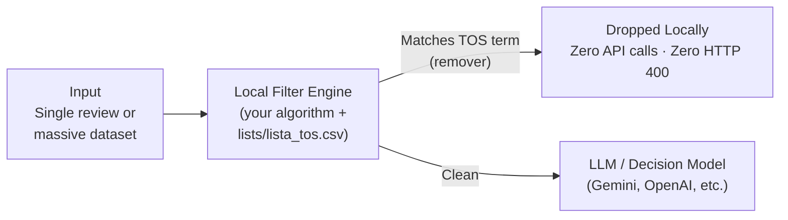

<div align="center">

<p>
  <strong>English</strong> ·
  <a href="README.pt.md">Português</a> ·
  <a href="README.es.md">Español</a>
</p>

# 🛡️ Steam Reviews Toxicity List

**A multilingual profanity & TOS-violation wordlist curated from Steam reviews to shield your LLM pipelines before inference.**

<p>
  
  
  
  <a href="LICENSE"></a>
</p>

</div>

> **Content Warning:** This repository contains offensive terms, hate speech, and sexually explicit language listed **strictly for defensive content moderation, safety research, and pre-LLM filtering**. This project does not endorse any listed term and must not be used for harassment or abusive content generation.
>
> *Independent open-source project, not affiliated with Valve/Steam, Google, OpenAI, Anthropic, or any AI provider.*

---

## Objective

Act as a **local, deterministic pre-inference shield** that detects and removes severe toxic user-generated text (Steam reviews, comments, chats, tickets) **before** it touches commercial LLM APIs with strict Terms of Service — such as **Google Gemini** (including `gemini-decision` models), **OpenAI**, and others.

### Problems and Risks Solved

Sending raw user-generated content (UGC) straight to LLM APIs exposes production pipelines to serious operational and account risks:

- **HTTP 400 Blocks (`PROHIBITED_CONTENT` / `TOS Violation`):** extreme content gets rejected at the gateway, breaking batch pipelines, stalling queues, and wasting retries.
- **Account Restriction, Suspension, or Ban Risk:** repeatedly sending severe TOS-violating text can trigger automated abuse-prevention systems at the LLM provider, leading to **rate throttling, API key revocation, project suspension, or permanent account bans**.
- **Wasted Latency & Cost:** paying tokens and network round-trips for text that will inevitably be blocked or offers no analytical value.
- **High False Positives from Generic Wordlists:** many public lists block common gaming/colloquial words (such as `die`, `morrer`, `aviso`, `caralho`). This TOS list focuses **strictly on high-risk terms**, leaving milder or context-dependent words for separate censorship layers.

---

## How It Works

The input can be anything from a **single review** to a **massive dataset** (hundreds of thousands or millions of Steam reviews). The filtering algorithm is completely up to you — regex, Aho-Corasick, Polars, DuckDB, Spark, or a lightweight local model.



### Architecture Note & Trade-off (Why `remover`?)

- **Reference Engine (Polars + Compiled Word-Boundary Regex):** In our reference pipeline, we run a deterministic local pre-filter in **Polars** designed for **ultra-fast throughput on CPU** (capable of filtering hundreds of thousands of reviews in seconds before any API call).
- **The Filtering Trade-off:** Past a certain point, trying to mask, censor, or sanitize severely toxic text with local string rules yields diminishing returns — the text loses analytical value and can still trigger LLM safety blocks. In practice, the best trade-off is to **drop (`remover`) high-risk TOS cases locally** at near-zero cost and let the **LLM / decision model** handle nuanced evaluation on the remaining clean data (reserving light censorship only for milder cases if needed).

---

## Repository Structure

```text
├── lists/
│   ├── tos/
│   │   ├── en.csv          # English terms
│   │   ├── pt.csv          # Portuguese terms
│   │   └── es.csv          # Spanish terms
│   └── lista_tos.csv       # Consolidated list (built from lists/tos/*.csv)
├── scripts/
│   └── build_and_validate.py
├── .github/workflows/
│   └── validate.yml        # Automated CI validation on Pull Requests
├── README.md               # English
├── README.pt.md            # Português
├── README.es.md            # Español
├── CONTRIBUTING.md
├── CODE_OF_CONDUCT.md
└── LICENSE
```

Each language has its own CSV under `lists/tos/` so native speakers can review and contribute easily. `lists/lista_tos.csv` automatically consolidates all languages.

---

## Column Schema

All CSV files use UTF-8 encoding and share the exact same 5-column schema:

| Column | Required | Description | Expected Values |
| :--- | :---: | :--- | :--- |
| `termo` | Yes | Exact lowercase word or phrase to block before inference. | e.g. `nigger`, `gay sex`, `beat women` |
| `classificacao` | Yes | Recommended action for the local filter. In the TOS list, **every entry must be `remover`** (drop/block the text before calling the API). | `remover` |
| `linguagem` | Yes | ISO 639-1 language code. Must match the filename `lists/tos/<linguagem>.csv`. | `en`, `pt`, `es`, `fr`, `de`, etc. |
| `motivo` | Yes | Technical reason the term is included. | `TOS Violation` |
| `categoria` | Yes | Policy violation category associated with the term. | `Discurso de ódio (Racismo)`, `Discurso de ódio (Homofobia)`, `Discurso de ódio (Capacitismo)`, `Violência / Discurso de ódio (Misoginia)`, `Conteúdo sexual explícito`, `Ameaça / Violência` |

---

## Local Validation & Build

After editing any file in `lists/tos/`, run the script to validate all entries and rebuild `lists/lista_tos.csv`:

```bash
python scripts/build_and_validate.py
```

To validate without modifying files (same check executed in CI):

```bash
python scripts/build_and_validate.py --check
```

---

## Contribute

Internet slang evolves fast, and every language has its own variations and evasion patterns. **Your contribution helps the community keep AI pipelines safer and more reliable.**

You can help in three ways:
1. **Add new terms** to an existing language (`lists/tos/en.csv`, `pt.csv`, `es.csv`).
2. **Add a new language** by creating `lists/tos/<iso_code>.csv` (e.g., `fr.csv`, `de.csv`, `it.csv`).
3. **Report false positives** via Issues if any term blocks legitimate game reviews.

Please read [CONTRIBUTING.md](CONTRIBUTING.md) before opening a Pull Request.

---

## License

Distributed under the [MIT License](LICENSE).
